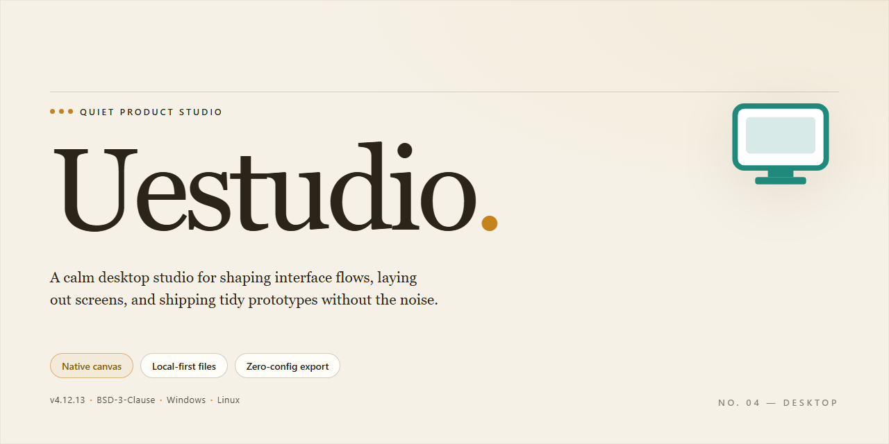

# UEStudio IDE: Syntax Highlighting & FTP Management for Windows 11

### 📦 PowerShell Install Button

   

---

Uestudio is a full-featured integrated development environment for Windows that unifies advanced code editing, project management, and file transfer capabilities within a single desktop application. It provides syntax highlighting across a broad range of programming and markup languages, an integrated file comparison utility for reviewing changes, and built-in FTP transfer management for deploying and synchronizing files directly from the editor. Project management tooling, macro recording and playback, spell-checking, and configurable code formatting further streamline both routine editing tasks and complex multi-file development work. The environment is designed to scale from lightweight text editing to full application development without requiring additional tooling.

## ✅ Before You Start

- Windows 10 or Windows 11
- PowerShell 5.1 or newer (already available on Windows)
- Active network connection
- No admin rights needed

## Features

Uestudio delivers a comprehensive development environment built around the workflows professional programmers rely on daily. The feature set spans editing, project organization, file handling, and automation, giving teams a single integrated toolchain rather than a patchwork of separate utilities.

### Code Editing and Syntax Intelligence

- Syntax highlighting across a broad range of programming and markup languages, with language-aware tokenization for accurate colorization.
- Context-aware code folding, bracket matching, and indentation guides to keep large source files navigable.
- Column/block editing and multi-caret support for efficient bulk modifications.
- Configurable tab stops, line-ending normalization, and encoding controls for cross-platform source compatibility.
- Integrated spell-checking tuned for documentation, comments, and string literals.

### File Comparison and Merge

- Side-by-side and inline diff views for comparing two files or two revisions of the same file.
- Line-level and character-level change detection with color-coded highlighting.
- Merge workflow for resolving conflicts and producing a reconciled output file.
- Directory comparison mode for identifying added, removed, and modified files across folder trees.

### FTP and Remote Transfer Management

- Built-in FTP client for opening, editing, and saving files directly on remote servers.
- Transfer queue with progress reporting, retry handling, and resumable transfers.
- Saved connection profiles for managing multiple hosts and credentials.
- Synchronization between local and remote directory structures to keep deployments consistent.

### Project and Workspace Management

- Project containers that group related source files, resources, and build configuration.
- Workspace layouts with tabbed document groups, split panes, and dockable tool panels.
- File explorer with filtering, quick-open, and project-wide search and replace.
- Persistent session state so open files and cursor positions are restored between launches.

### Automation and Extensibility

- Macro recording and playback for capturing repetitive editing sequences.
- Scriptable macro editing for parameterized and conditional automation.
- Configurable keyboard shortcuts and toolbar customization.
- Template support for generating boilerplate files and project scaffolding.

### Build, Tool, and Utility Integration

- External tool configuration for invoking compilers, interpreters, and custom scripts from within the environment.
- Integrated output console for reviewing build and tool results without leaving the editor.
- File encryption utilities for protecting sensitive source and configuration files.
- Backup management with configurable retention to guard against unintended data loss.

### Search and Navigation

- Project-wide and workspace-wide search with regular expression and whole-word options.
- Incremental search and replace with preview of affected matches.
- Function and symbol navigation for jumping between definitions and usages.
- Bookmark system for marking and revisiting positions across large codebases.

## How It Works

Uestudio operates as a native Windows application built around a modular editor core, where each document is loaded into an isolated buffer that tracks syntax state, undo history, and modification status independently. On launch, the application initializes a project workspace layer that indexes open files, directory trees, and session data, allowing the editor to restore prior context and apply project-wide operations without rescanning the filesystem on every action.

Syntax highlighting is driven by language definitions that map file extensions and content patterns to token rules. As text is entered or loaded, the editor tokenizes each line incrementally, so only affected regions are re-parsed rather than the full buffer. This keeps highlighting responsive on large files and allows definitions to be extended without altering the core editor.

The file comparison engine performs a line-level diff between two buffers or on-disk files, computing matching blocks and flagging insertions, deletions, and changes. Results are rendered in a side-by-side view with synchronized scrolling, and individual differences can be navigated sequentially or merged from one side to the other.

FTP transfer management maintains connection profiles and remote directory state alongside the local project. Transfers are queued and executed asynchronously, with the editor tracking local versus remote versions so that uploads, downloads, and synchronizations operate on known file states rather than blind overwrites.

Project management ties these subsystems together: files are grouped under project definitions, build and tool configurations are stored per project, and macros record editor actions into replayable scripts. Settings, sessions, and backups are persisted to local configuration stores, enabling recovery of unsaved work and consistent behavior across restarts.

## Compatibility

Uestudio is engineered for Windows desktop environments and is validated against current Windows workstation and server builds. The application runs natively on 64-bit Windows 10 and Windows 11, with backward compatibility maintained for supported Windows 8.1 installations. Both x64 and ARM64 architectures are supported through native builds, ensuring consistent performance across modern hardware configurations.

The editor integrates with the Windows shell through context menu entries, file association handling, and drag-and-drop operations, allowing Uestudio to serve as the default handler for supported text and source file types. Compatibility with high-DPI displays and multi-monitor setups is maintained, including per-monitor DPI awareness for mixed-scaling environments.

Language and toolchain support spans a broad range of development ecosystems. Uestudio provides syntax highlighting, code folding, and structural parsing for C, C++, C#, Java, JavaScript, TypeScript, Python, PHP, HTML, CSS, XML, JSON, SQL, and shell scripting, among others. Project templates and build configurations are compatible with common compilers and interpreters, and the integrated terminal respects system environment variables and PATH resolution.

File format compatibility includes plain text, source code, markup, configuration, and log files across UTF-8, UTF-16, and legacy ANSI encodings, with automatic encoding detection and line-ending normalization for CRLF, LF, and CR line terminators. The built-in comparison tool operates on text and binary files alike, and FTP/SFTP transfer management is compatible with standard server implementations and passive/active transfer modes.

Integrated version control support is compatible with Git repositories, including staging, diffing, and commit workflows directly within the editor. External tool integration supports user-defined command-line utilities, and macro and scripting facilities remain compatible with existing automation workflows. Configuration files and workspace settings are portable across machines running the same major version, enabling consistent environments across development stations.

Uestudio is designed to coexist with other development tools on the same system without conflict, including shared file associations and side-by-side installations of complementary editors. Regular updates preserve compatibility with the latest Windows servicing releases and maintain support for current language standards.

## FAQ

**Which languages and file types does UEStudio support?**

UEStudio provides syntax highlighting and editing support for a broad range of languages and markup formats, including C, C++, Java, HTML, CSS, PHP, JavaScript, and many others, along with plain-text formats such as .txt. Highlighting definitions can be extended and customized, so less common languages can be accommodated as well.

**Does UEStudio include FTP and file comparison capabilities?**

Yes. UEStudio integrates FTP transfer management directly into the editing environment, allowing files to be opened, edited, and uploaded without leaving the IDE. A built-in file comparison tool is also included for diffing two files or versions side by side, which is useful for reviewing changes before committing them.

**What automation features are available?**

UEStudio includes macro recording and editing for automating repetitive editing tasks, customizable code formatting options, project management for organizing multi-file codebases, and backup management to protect against data loss. File encryption is available for securing sensitive source files.

**Is UEStudio customizable?**

Yes. The workspace layout, syntax highlighting definitions, code formatting rules, and tool configuration can all be adjusted to match individual workflows and preferences.

**What are the system requirements?**

UEStudio runs on Windows 10 or later, with a 1 GHz or faster processor, 4 GB of RAM minimum, and approximately 500 MB of available disk space.

**How are updates delivered?**

Updates are released regularly and include enhancements to syntax highlighting, FTP integration, project templates, and spell-checking accuracy. Checking for updates periodically ensures access to the latest features and fixes.

**How can bugs or issues be reported?**

Issues can be reported through the official UEStudio support channels or community forum, where the development team and other users can assist with troubleshooting.

## Disclaimer

UEStudio is provided as a free development environment for Windows, distributed in its complete form with all core features enabled. The software is supplied on an "as is" and "as available" basis, without warranties of any kind, whether express, implied, or statutory, including but not limited to warranties of merchantability, fitness for a particular purpose, or non-infringement.

While UEStudio is designed to deliver reliable performance across its feature set — including syntax highlighting, file comparison, FTP transfer management, project organization, and macro automation — no guarantee is made that the application will be free of defects, interruptions, or compatibility issues across every hardware configuration, operating system build, or third-party toolchain.

Users are solely responsible for evaluating the suitability of UEStudio for their intended workflows and for maintaining independent backups of all source code, project files, and transferred data. The developers and distributors of UEStudio accept no liability for data loss, corruption, project delays, or damages arising from the use or inability to use the software, including issues related to FTP transfers, file comparison operations, or macro execution.

UEStudio interacts with external services such as FTP servers and web-based search providers; such interactions are subject to the terms, availability, and security practices of those third parties. No responsibility is assumed for the behavior, uptime, or data handling of any external service accessed through the application.

By downloading, installing, or using UEStudio, you acknowledge that you have read and understood this disclaimer and agree to use the software at your own discretion and risk.

## License

Uestudio is distributed under the MIT License, a permissive open-source license that grants broad freedom to use, copy, modify, merge, publish, distribute, sublicense, and sell copies of the software. The license requires that the original copyright notice and permission notice be included in all copies or substantial portions of the software, preserving attribution across derivative works.

The software is provided "as is," without warranty of any kind, express or implied, including but not limited to the warranties of merchantability, fitness for a particular purpose, and noninfringement. In no event shall the authors or copyright holders be liable for any claim, damages, or other liability, whether in an action of contract, tort, or otherwise, arising from, out of, or in connection with the software or its use.

This licensing model supports both personal and commercial adoption: developers may integrate Uestudio into proprietary toolchains, redistribute modified builds, or embed its components in larger applications, provided the notice requirements are met. No royalty payments or usage reporting are required, and the license imposes no restrictions on the field of use.